# 티업링크 사용설명서

골프 동호회 운영을 앱 하나로. 클럽 개설부터 라운딩 모집, 스코어 기록, 비용 정산까지.

이 문서는 실제 앱 화면을 순서대로 따라갑니다. 처음이시면 **시나리오 1**부터 차례로 보세요.

| 시나리오 | 내용 | 누가 |
| --- | --- | --- |
| [1. 가입절차](#시나리오-1-가입절차) | 설치부터 첫 화면까지 | 모두 |
| [2. 클럽등록절차](#시나리오-2-클럽등록절차) | 클럽 가입 / 클럽 개설 / 운영 | 모두 · 리더 |
| [3. 라운딩등록절차](#시나리오-3-라운딩등록절차) | 라운딩 모집부터 종료까지 | 리더 · 매니저 |
| [4. 모임등록절차](#시나리오-4-모임등록절차) | 식사·뒤풀이 같은 소셜 모임 | 리더 · 매니저 |
| [5. 기록등재절차](#시나리오-5-기록등재절차) | 스코어 입력, 통계, 비용 정산 | 모두 |

---

## 시나리오 1. 가입절차

### 1-1. 앱 설치

- **iPhone** — App Store에서 `티업링크` 검색
- **Android** — Play 스토어에서 `티업링크` 검색

### 1-2. 로그인

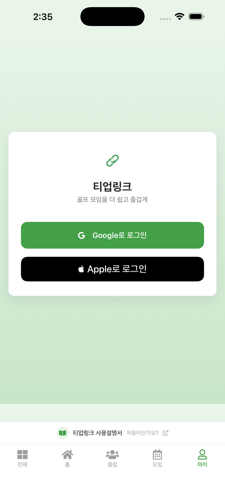

앱을 켜면 이 화면이 나옵니다. 둘 중 편한 쪽을 누르세요.

- **Google로 로그인**
- **Apple로 로그인** (iPhone만)

따로 아이디와 비밀번호를 만들 필요가 없습니다. 처음 로그인하는 순간 계정이 만들어집니다.

> 기기를 바꿔도 같은 계정으로 로그인하면 기록이 그대로 따라옵니다.

### 1-3. 약관 동의

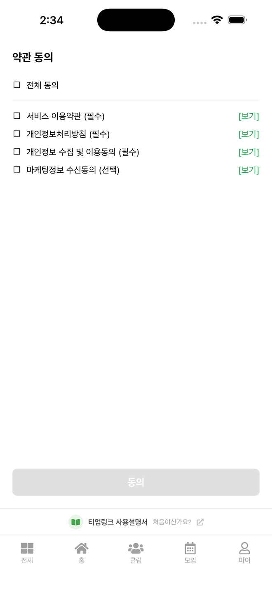

첫 로그인이면 약관 동의 화면이 나옵니다.

| 항목 | 필수 여부 |
| --- | --- |
| 서비스 이용약관 | **필수** |
| 개인정보처리방침 | **필수** |
| 개인정보 수집 및 이용 | **필수** |
| 마케팅정보 수신 | 선택 |

**전체 동의**를 누르면 한 번에 체크됩니다. 각 항목 오른쪽의 **[보기]**를 누르면 전문을 읽을 수 있습니다. 마케팅정보 수신은 체크하지 않아도 모든 기능을 쓸 수 있습니다.

### 1-4. 프로필 작성

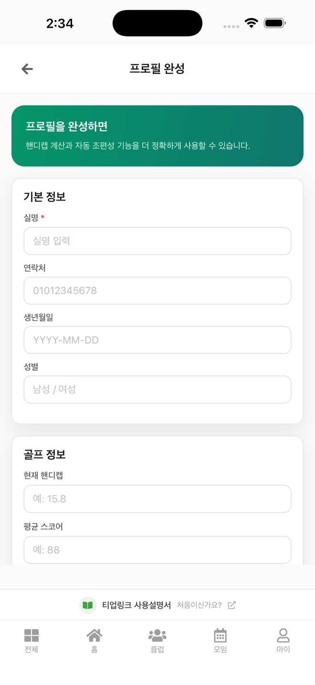

| 항목 | 필수 여부 | 설명 |
| --- | --- | --- |
| 성명 | **필수** | 실명. 참가자 명단과 정산에 표시됩니다 |
| 연락처 | 선택 | 운영진이 급한 연락을 할 때 씁니다 |
| 생년월일 | 선택 | 팀 편성에서 연령대를 고려할 때 씁니다 |
| 성별 | 선택 | 티박스 추천에 씁니다 |
| 현재 핸디캡 | 선택 | 나중에 기록이 쌓이면 자동으로 계산됩니다 |
| 평균 스코어 | 선택 | 위와 같습니다 |

> 골프 정보는 비워 두어도 됩니다. 라운딩 기록을 몇 번 올리면 앱이 알아서 평균타수와 핸디캡을 계산해 줍니다.

### 1-5. 홈 화면

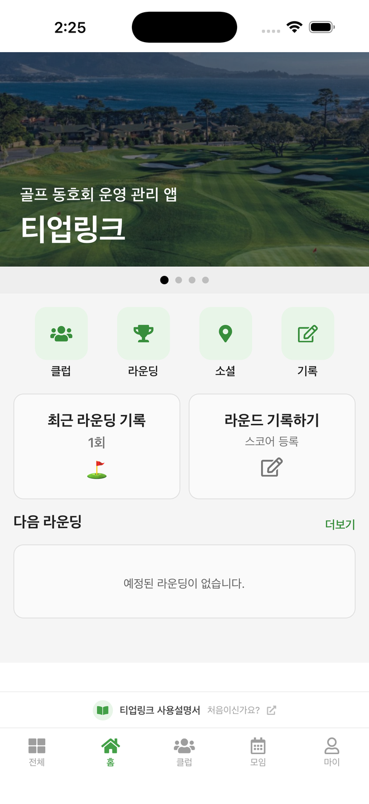

가입이 끝나면 홈으로 들어옵니다.

- **빠른 메뉴** — 클럽 / 라운딩 / 소셜 / 기록
- **최근 라운딩 기록** — 최근에 친 라운딩 수
- **라운드 기록하기** — 모임과 상관없이 혼자 스코어를 남길 때
- **다음 라운딩** — 참가 신청한 다음 일정

화면 맨 아래 다섯 개 탭이 어디서나 따라다닙니다.

| 탭 | 하는 일 |
| --- | --- |
| **전체** | 모든 메뉴를 펼쳐 봅니다 |
| **홈** | 다음 라운딩, 최근 기록, 바로가기 |
| **클럽** | 내 클럽, 클럽 찾기 |
| **모임** | 라운딩·소셜 모임 목록 |
| **마이** | 내 정보, 내 모임, 기록, 알림 |

탭바 바로 위의 **티업링크 사용설명서** 띠를 누르면 이 문서가 열립니다.

---

## 시나리오 2. 클럽등록절차

티업링크는 **클럽**이 중심입니다. 모임을 만들고 참가하려면 먼저 클럽에 속해야 합니다.
이미 있는 클럽에 **가입**하거나, 직접 **개설**하거나 둘 중 하나입니다.

### 2-1. 클럽 찾아 가입하기

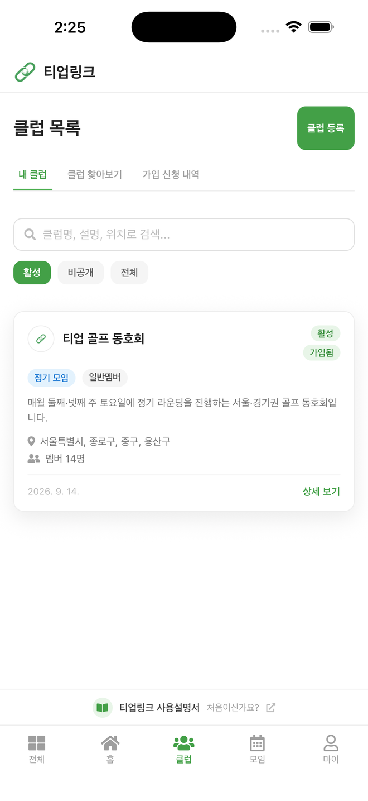

**클럽** 탭을 누르면 클럽 목록이 나옵니다.

- 위쪽 **내 클럽 / 클럽 찾아보기 / 가입 신청 내역** 으로 나뉩니다
- 검색창에 **클럽명, 설명, 지역**을 넣어 찾습니다
- **정기 / 비정기 / 전체** 로 걸러 볼 수 있습니다

마음에 드는 클럽을 눌러 들어간 뒤 **가입 신청**을 누르면 끝입니다.
신청하면 **승인 대기** 상태가 되고, 클럽 리더나 매니저가 승인하면 멤버가 됩니다. 승인되면 알림이 옵니다.

> 가입 신청 현황은 **클럽 탭 → 가입 신청 내역**에서 확인합니다.

### 2-2. 클럽 만들기

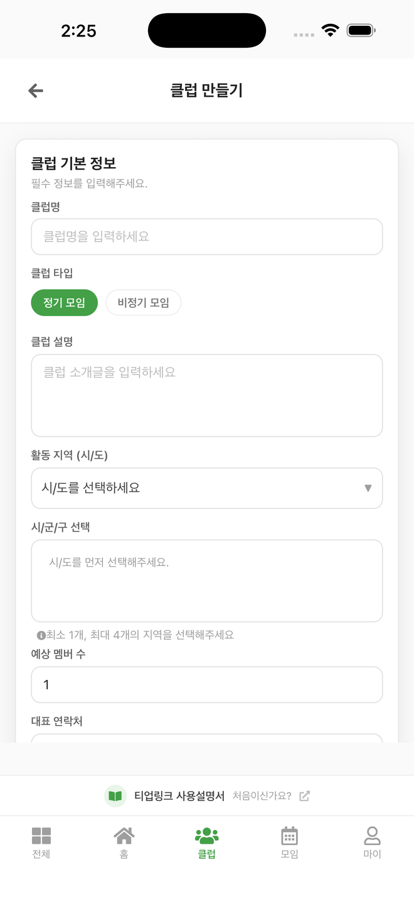

**클럽 탭 오른쪽 위 [클럽 등록]** 또는 **전체 메뉴 → 클럽 만들기**.

| 입력 항목 | 필수 | 설명 |
| --- | --- | --- |
| 클럽명 | **필수** | 예) 주말 골프 모임 |
| 클럽 타입 | **필수** | 정기 모임 / 비정기 모임 |
| 클럽 설명 | 선택 | 어떤 모임인지, 어떤 분을 환영하는지 |
| 활동 지역 | **필수** | 시/도 → 시/군/구. 여러 개 고를 수 있습니다 |
| 예상 멤버 수 | **필수** | 예) 20 |
| 대표 연락처 | 선택 | 문의받을 연락처 |

만들면 본인이 자동으로 **리더**가 됩니다.

> 클럽명과 설명에 욕설이나 광고성 문구가 들어가면 등록되지 않습니다.

### 2-3. 클럽 상세 화면

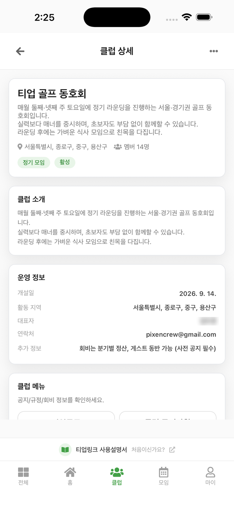

클럽에 들어가면 보이는 화면입니다.

- **클럽 소개** — 소개글, 활동 지역
- **운영 정보** — 개설일, 활동 지역, 대표자, 연락처, 추가 정보
- **클럽 메뉴** — 공지사항 / 클럽 규정 / 회비 / 멤버 / 라운딩 기록 / 통계

오른쪽 위 **⋯** 버튼으로 신고하거나 차단할 수 있습니다.

### 2-4. 멤버 확인

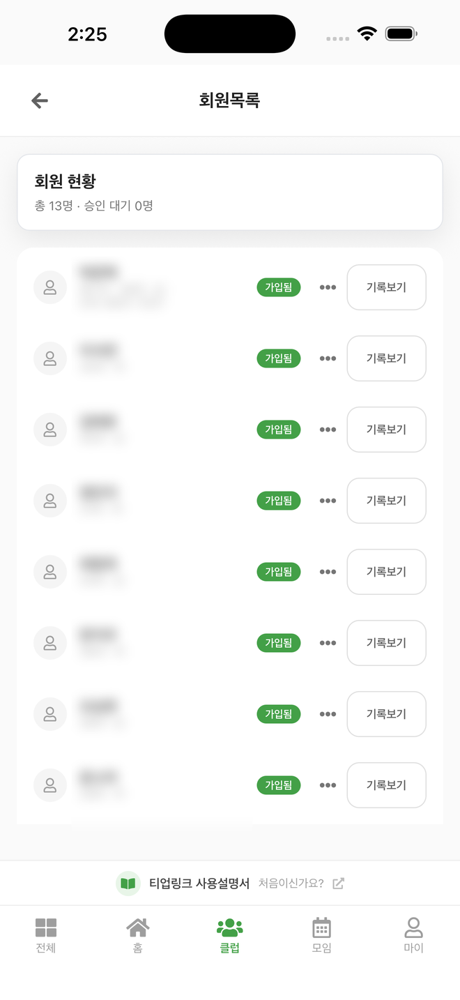

**회원 현황**에 전체 인원과 승인 대기 인원이 나옵니다.
각 줄에는 이름, 등급, 나이, 성별이 보이고 **[기록보기]**로 그 사람의 라운딩 기록을 볼 수 있습니다.

> 위 캡처는 공개용이라 개인정보를 가렸습니다. 실제 앱에서는 그대로 보입니다.

**멤버 등급**

| 등급 | 권한 |
| --- | --- |
| **리더** | 모든 권한. 클럽 정보 수정, 멤버 승인·등급 변경 |
| **매니저** | 모임 개설, 공지·규정 작성, 가입 승인 |
| **일반멤버** | 모임 참가, 기록 확인 |

### 2-5. 클럽 관리 (리더·매니저만)

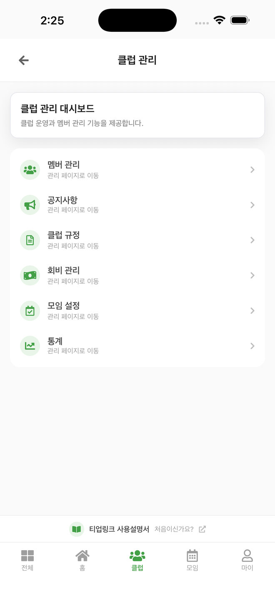

클럽 상세 → **클럽 관리**. 운영에 필요한 메뉴가 한곳에 모여 있습니다.

| 메뉴 | 하는 일 |
| --- | --- |
| **멤버 관리** | 가입 신청 승인·반려, 등급 변경, 멤버 메모 |
| **공지사항** | 공지 작성·수정·삭제 |
| **클럽 규정** | 회칙, 라운딩 규칙을 카테고리별로 정리 |
| **회비 관리** | 금액과 납부 주기 설정 |
| **모임 설정** | 모임을 만들 때 쓸 기본값 |
| **통계** | 클럽 활동 통계 |

### 2-6. 공지사항

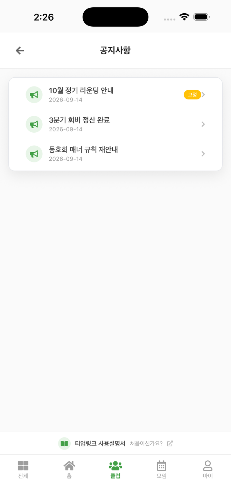

운영진이 올린 공지가 최신순으로 쌓입니다. 중요한 공지는 위에 고정됩니다.
멤버는 읽기만 하고, 작성은 리더와 매니저만 할 수 있습니다.

### 2-7. 회비

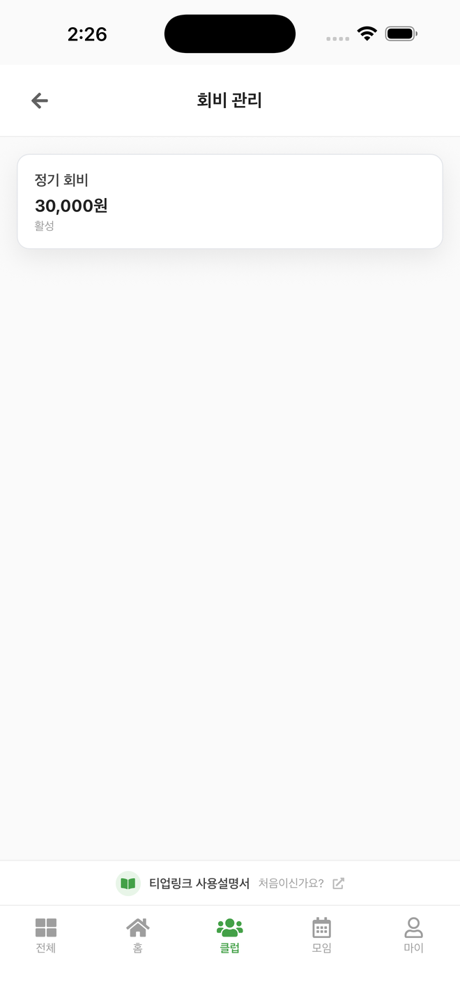

정기 회비의 금액과 주기를 보여 줍니다. 주기는 **월 1회 / 분기 1회 / 연 1회 / 일회성** 중에서 고릅니다.

> 티업링크는 회비를 **안내하고 기록**만 합니다. 실제 입금은 앱 밖에서 하세요.

### 2-8. 클럽 통계

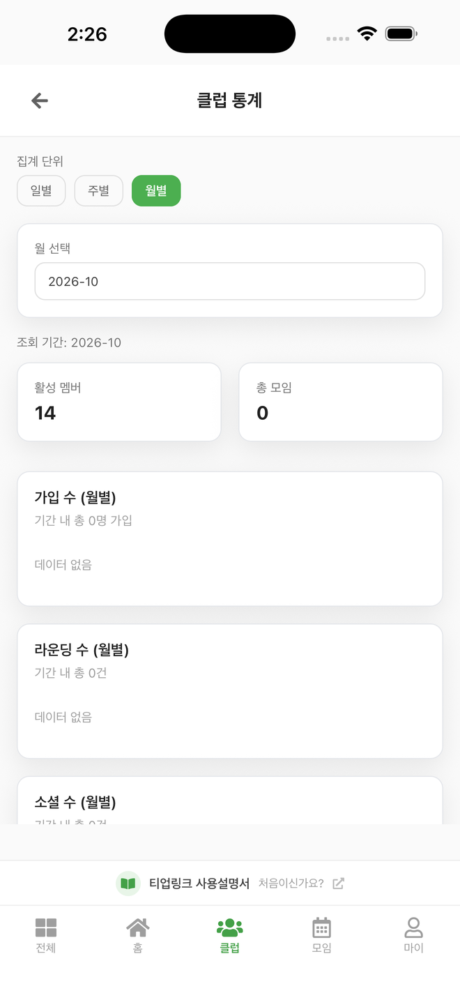

기간을 **일별 / 주별 / 월별**로 바꿔 가며 봅니다.

- 회원 수, 총 모임 수
- 가입 수, 라운딩 수, 소셜 모임 수

---

## 시나리오 3. 라운딩등록절차

실제 골프 라운딩을 모집하고 진행하는 절차입니다. **리더와 매니저만** 모임을 만들 수 있습니다.

### 3-1. 모임 목록 보기

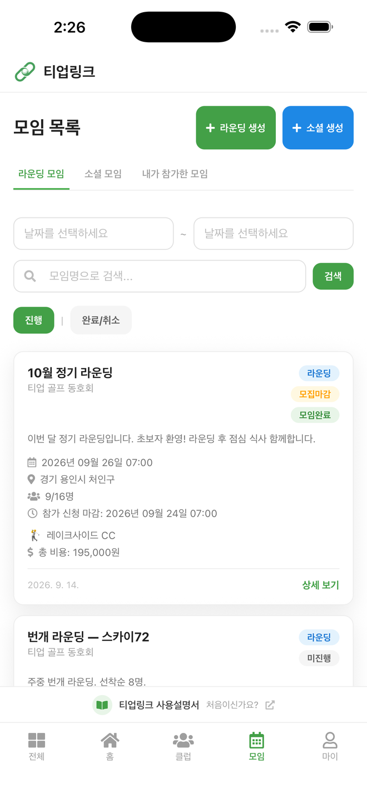

**모임** 탭입니다. **라운딩 모임 / 소셜 모임 / 내가 개설한 모임** 으로 나뉩니다.

- 날짜 범위와 검색어로 거를 수 있습니다
- **전체 / 모집중 / 모집마감** 으로 상태를 거릅니다
- 각 카드에 날짜, 장소, 참가 현황, 1인 비용이 요약돼 있습니다

오른쪽 위 **[+ 라운딩 생성] [+ 소셜 생성]** 으로 바로 만들 수 있습니다.

### 3-2. 라운딩 모임 만들기

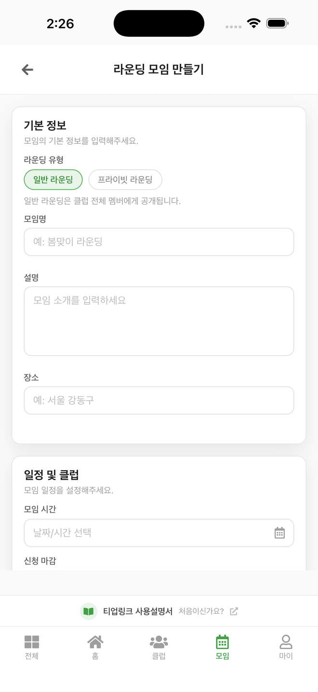

**모임 탭 → [+ 라운딩 생성]** 또는 **전체 메뉴 → 라운딩 모임 만들기**.

| 입력 항목 | 필수 | 예시 |
| --- | --- | --- |
| 라운딩 유형 | **필수** | 일반 라운딩 / 우리끼리 라운딩 |
| 모임명 | **필수** | 10월 정기 라운딩 |
| 설명 | 선택 | 초보 환영, 라운딩 후 식사 |
| 장소 | **필수** | 시/도 → 시/군/구 |
| 모임 시간 | **필수** | 날짜와 시간 |
| 신청 마감 | **필수** | 참가 신청을 닫을 시각 |
| 클럽 | **필수** | 어느 클럽의 모임인지 |
| 골프장명 | **필수** | 레이크사이드 CC |
| 홀 수 | **필수** | 18홀 / 9홀 |
| 예약자명 | 선택 | 예약을 건 사람 |
| 티타임 | 선택 | 07:00, 08:08, 09:00 |
| 정원 | **필수** | 16 |
| 비용 | 선택 | 그린피 / 카트비 / 캐디피 |

> **우리끼리 라운딩**은 클럽 멤버에게만 보이고, 초대한 사람에게만 알림이 갑니다.

### 3-3. 모임 상세 — 모집 중

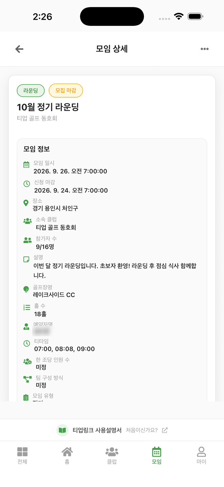

만들고 나면 이 화면이 됩니다. 위쪽에 **모집중 / 모집 마감** 같은 상태 배지가 붙습니다.

**모임 정보**에 날짜, 신청 마감, 장소, 소속 클럽, 참가자 수, 설명, 골프장명, 홀 수, 예약자명, 티타임, 한 조당 인원 수, 팀 구성 방식이 모두 나옵니다.

- 멤버는 화면 아래 **참가 신청** 을 누릅니다. 마음이 바뀌면 **참가신청 취소**
- 신청 마감 시각이 지나거나 운영진이 **신청 마감하기**를 누르면 더 이상 신청할 수 없습니다
- 화면 아래쪽 **참가자 / 팀 / 정산** 탭에서 현황을 봅니다

**게스트 추가** — 클럽 멤버가 아닌 지인을 데려갈 때는 운영진이 **게스트**로 추가합니다. 이름만 넣으면 되고 정산에도 함께 잡힙니다.

**팀 편성** — 라운딩 전에 운영진이 조를 짭니다.

모임 상세를 아래로 내리면 **참가자 / 팀 / 정산** 탭이 있습니다. **팀** 탭을 누르면 편성된 조가 보입니다.

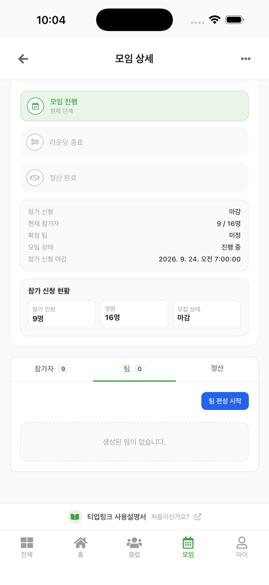

아직 조가 없으면 **생성된 팀이 없습니다** 로 나오고, 운영진에게만 **[팀 편성 시작]** 버튼이 보입니다.

**팀 탭이 열리는 조건** — 아래를 모두 만족해야 합니다. 하나라도 어긋나면 팀 탭이 비활성으로 보입니다.

| 조건 | 설명 |
|---|---|
| 라운딩 모임 | 소셜 모임에는 팀 편성이 없습니다 |
| 참가자 4명 이상 | 3명 이하면 조를 짤 수 없습니다 |
| 신청 마감됨 | 마감 시각이 지났거나 **[신청 마감하기]** 를 눌렀을 때 |

편성 버튼은 여기에 더해 **운영진(리더·매니저)** 이고 **모임 시각이 아직 안 지났을 때**만 뜹니다. 취소되었거나 정산이 확정된 모임에서도 사라집니다.

**1단계 — 편성 조건 고르기**

**[팀 편성 시작]** 을 누르면 조건 창이 먼저 뜹니다.

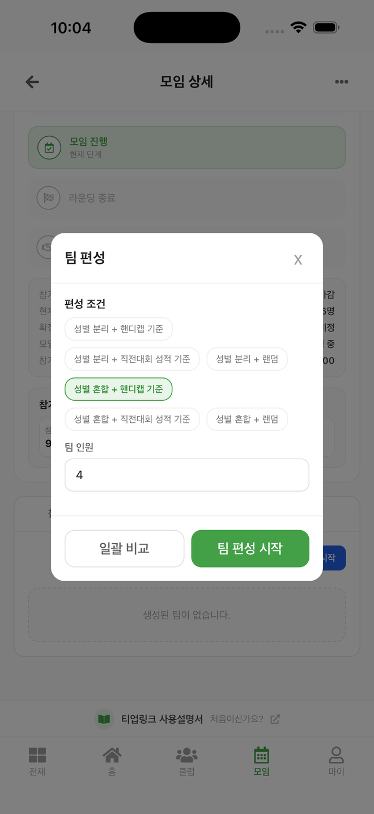

| 항목 | 설명 |
|---|---|
| 편성 조건 | 성별 분리/혼합 × 핸디캡·직전대회 성적·랜덤, 6가지 |
| 팀 인원 | 한 조에 몇 명씩 넣을지 (기본 4) |
| 일괄 비교 | 여러 조건으로 짠 결과를 한 번에 비교해 봅니다 |

**2단계 — 결과 확인**

편성이 끝나면 팀 탭에 조별 명단이 나옵니다.

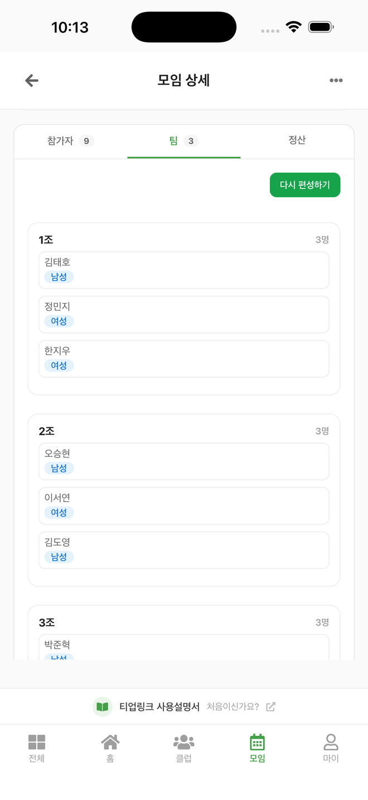

조 이름 옆에 인원수가, 각 멤버에는 성별이 함께 표시됩니다. 버튼은 **[다시 편성하기]** 로 바뀝니다. 편성을 한 번이라도 돌리고 나면 옆에 **[편성 히스토리]** 가 생겨서 지난 편성 결과를 다시 볼 수 있습니다.

**3단계 — 손으로 고치기**

**[다시 편성하기]** 를 누르면 **팀 편성 수정** 창이 열립니다. 자동 편성 결과를 그대로 쓰지 않고 손으로 바꿀 때 씁니다.

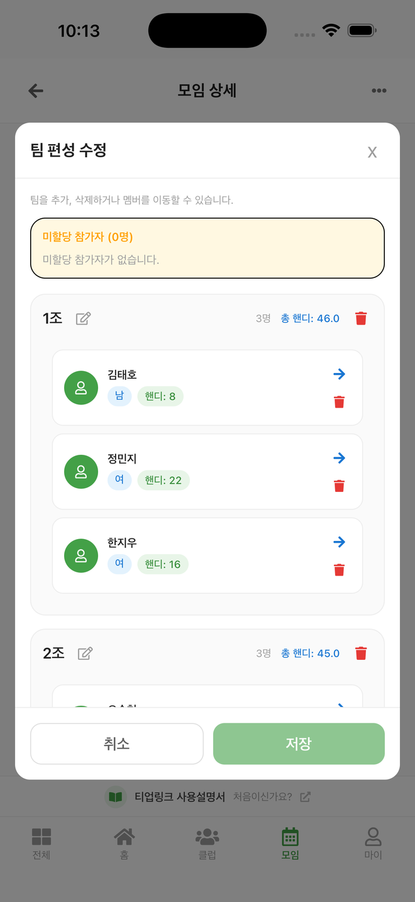

맨 위 **미할당 참가자** 칸에 아직 조에 못 들어간 사람이 모입니다. 조마다 **총 핸디**가 같이 보여서 조별 전력을 맞추기 좋습니다.

- 멤버 오른쪽 **→** 를 누르면 다른 조로 옮깁니다
- **휴지통**을 누르면 그 멤버를 미할당으로 빼거나, 조 전체를 지웁니다
- 조 이름 옆 **연필**로 이름을 바꿉니다 (1조, 2조 … 를 A조, B조 같은 식으로)

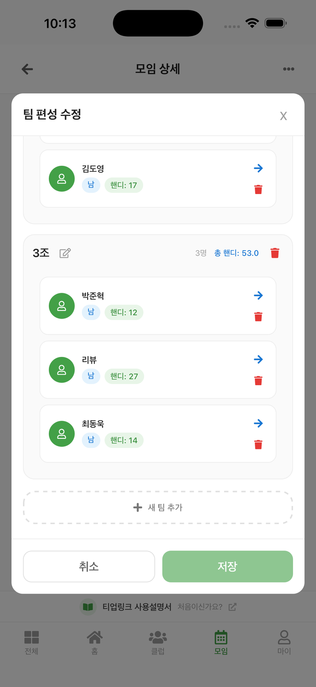

맨 아래 **+ 새 팀 추가**로 조를 하나 더 만들고, 다 고쳤으면 **[저장]** 을 누릅니다. **[취소]** 로 나가면 바뀐 내용은 버려집니다.

> 티업 시간이 지나면 편성을 더 이상 고칠 수 없습니다.

### 3-4. 모임 상세 — 완료

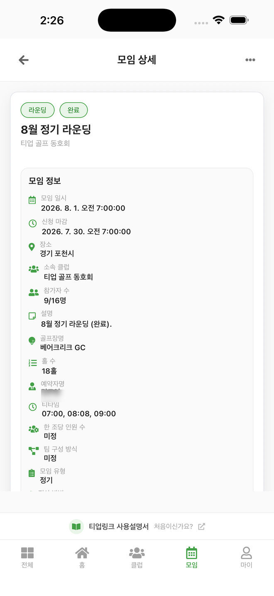

라운딩이 끝나고 **라운딩 종료**를 누르면 **완료** 배지로 바뀝니다. 이때부터 스코어와 정산을 정리합니다.

**진행 단계**

| 단계 | 누가 | 무엇을 |
| --- | --- | --- |
| 신청 마감 | 운영진 | 참가자 확정 |
| 팀 편성 | 운영진 | 조 편성 |
| 라운딩 시작 | 운영진 | 진행 상태로 전환 |
| 점수 입력 | 참가자·운영진 | 스코어 기록 |
| 라운딩 종료 | 운영진 | 기록 확정 |
| 정산 완료 | 운영진 | 비용 분배 |

### 3-5. 내 모임

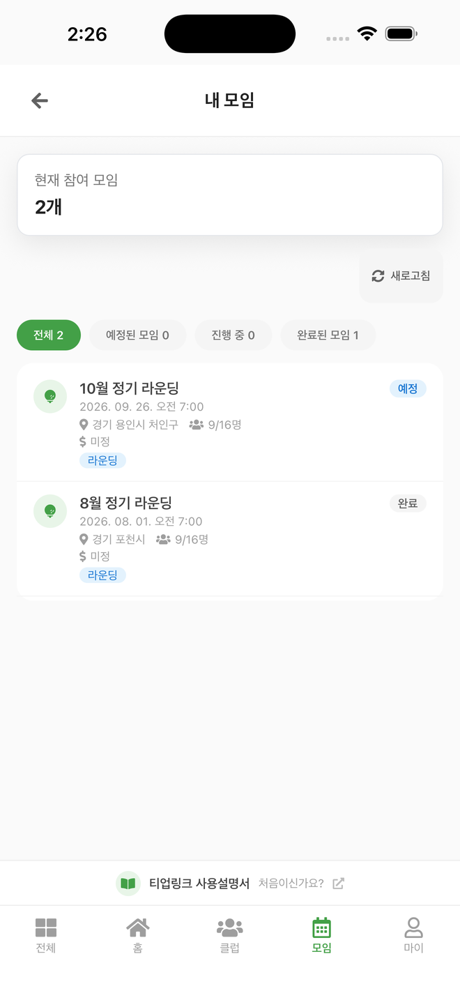

**모임 탭 → 내가 개설한 모임** 또는 **마이 → 내 참여내역**.
신청했거나 참가한 모임을 **전체 / 예정된 모임 / 진행 중 / 완료된 모임** 으로 나눠 봅니다.

---

## 시나리오 4. 모임등록절차

라운딩이 아닌 모임 — 식사, 뒤풀이, 스크린골프, 번개 — 은 **소셜 모임**으로 만듭니다.
골프장이나 홀 수 같은 항목이 없어 훨씬 간단합니다.

### 4-1. 소셜 모임 만들기

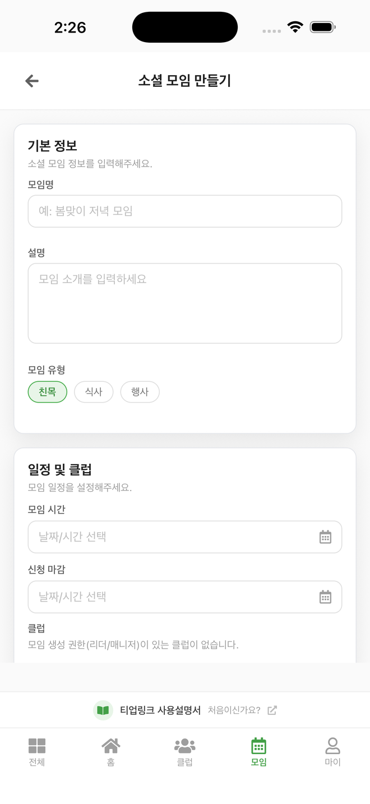

**모임 탭 → [+ 소셜 생성]** 또는 **전체 메뉴 → 소셜 모임 만들기**.

| 입력 항목 | 필수 | 예시 |
| --- | --- | --- |
| 모임명 | **필수** | 10월 라운딩 뒤풀이 |
| 설명 | 선택 | 라운딩 불참자도 환영 |
| 모임 유형 | **필수** | 친목 / 식사 / 행사 |
| 모임 시간 | **필수** | 날짜와 시간 |
| 신청 마감 | **필수** | 참가 신청을 닫을 시각 |
| 클럽 | **필수** | 어느 클럽의 모임인지 |
| 장소 | **필수** | 강남 한우명가 |
| 정원 | **필수** | 20 |
| 정산 방법 | 선택 | N분의 1 등 |

### 4-2. 소셜 모임 상세

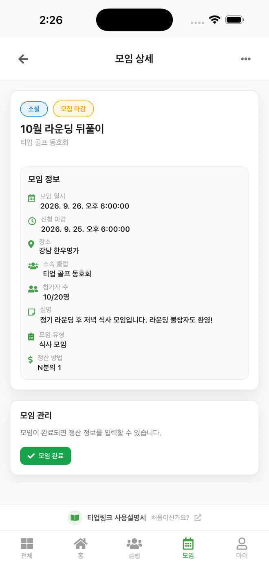

라운딩과 같은 방식으로 **참가 신청**을 받습니다.

- **모임 정보** — 날짜, 장소, 소속 클럽, 참가자 수, 모임 유형, 정산 방법
- **모임 관리** — 모임이 끝나면 **모임 완료**를 눌러 정산 정보를 입력할 수 있게 합니다

> 참가 대상을 **모든 클럽 멤버**로 둘지, 특정 인원만 초대할지 고를 수 있습니다.

---

## 시나리오 5. 기록등재절차

라운딩이 끝난 뒤 스코어를 남기고 비용을 나누는 절차입니다.

### 5-1. 점수 입력

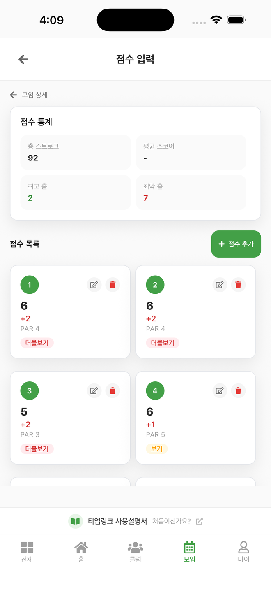

모임 상세 → **점수 입력**. 홀별로 타수를 넣습니다.

- **[+ 점수 추가]** 로 홀을 하나씩 추가합니다
- 홀 번호, 타수, 파를 넣으면 **파 대비 타수**가 자동 계산됩니다
- 이미 넣은 홀은 눌러서 고치거나 지울 수 있습니다

> 모임과 상관없이 혼자 기록하려면 **홈 → 라운드 기록하기**를 쓰세요.

### 5-2. 모임 통계

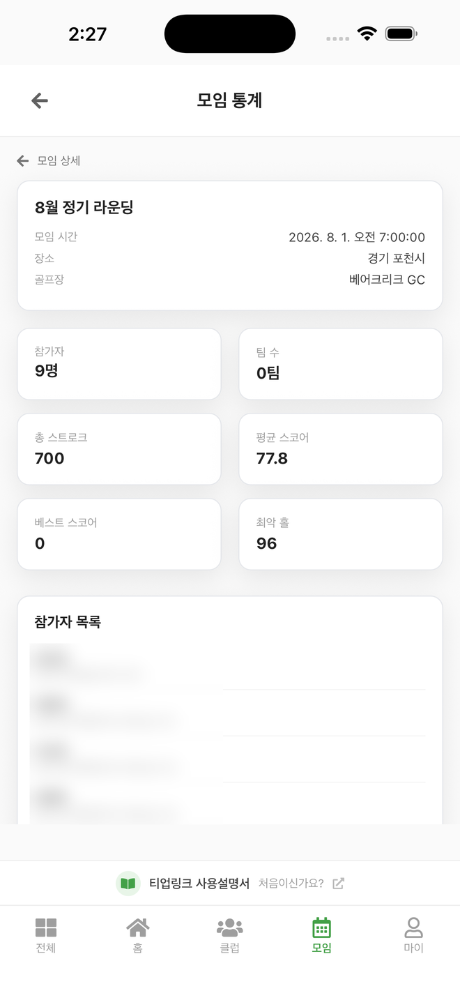

모임 상세 → **점수 통계**. 그 라운딩의 결과가 한 장에 정리됩니다.

- 참가자 수, 점수 입력 완료 수
- **총 스트로크**, **평균 스코어**
- **베스트 스코어**, **워스트 스코어**
- 참가자 목록

### 5-3. 정산 (비용 나누기)

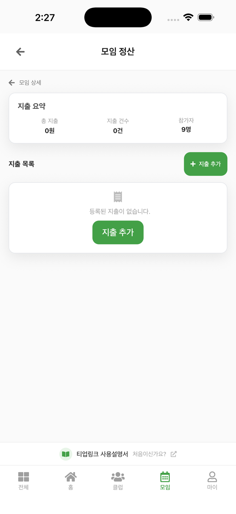

모임 상세 → **정산/경비**. 라운딩에 들어간 돈을 참가자끼리 나눕니다.

**지출 요약** — 총 지출, 미정산 금액, 참가 인원이 위쪽에 나옵니다.

**지출 추가** 순서

1. **[+ 지출 추가]** 를 누릅니다
2. 항목명과 금액을 넣습니다 (그린피, 카트비, 식비 등)
3. **누가 부담할지** 고릅니다 — 전원이면 1/N, 일부만이면 그 사람들끼리
4. 1인당 금액이 자동으로 계산됩니다
5. 받은 사람은 체크해서 **납부 완료**로 표시합니다
6. 다 받으면 **정산 완료 처리**

> 티업링크는 금액을 **계산하고 기록**만 합니다. 실제 송금은 앱 밖에서 하세요. 앱 안에서 결제되는 것은 없습니다.

### 5-4. 내 기록

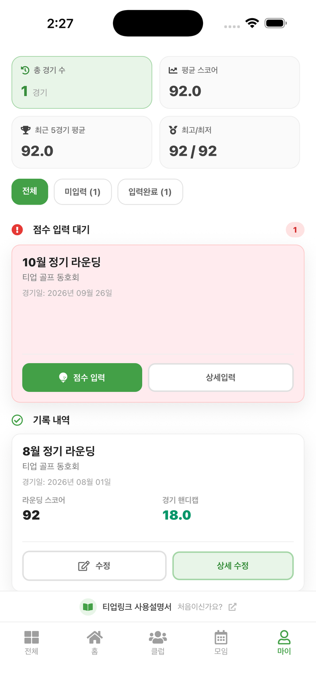

**마이 → 기록**. 내가 친 라운딩이 쌓입니다.

- **총 라운드 수**, **평균 스코어**, **최근 스코어**, **최고 스코어**
- **점수 입력 대기** — 아직 스코어를 안 넣은 모임이 빨간 카드로 뜹니다. **[점수 입력]** 을 눌러 바로 넣을 수 있습니다
- **기록 내역** — 모임별 스코어와 환산 핸디캡. **[수정] [상세 수정]** 으로 고칠 수 있습니다

### 5-5. 마이페이지

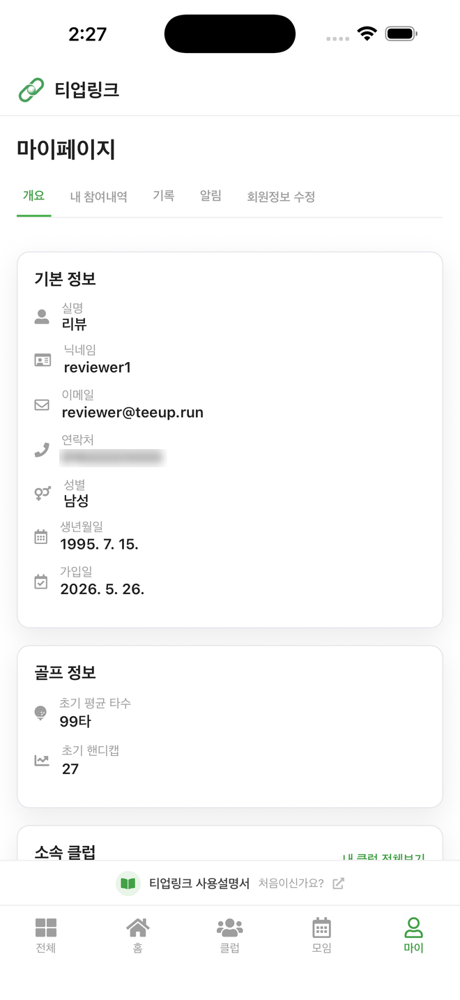

**마이** 탭입니다. **개요 / 내 참여내역 / 기록 / 알림 / 회원정보 수정** 으로 나뉩니다.

- **기본 정보** — 이름, 닉네임, 이메일, 연락처, 성별, 생년월일, 가입일
- **골프 정보** — 초기 평균 타수, 초기 핸디캡
- **소속 클럽** — 가입한 클럽 목록

### 5-6. 알림

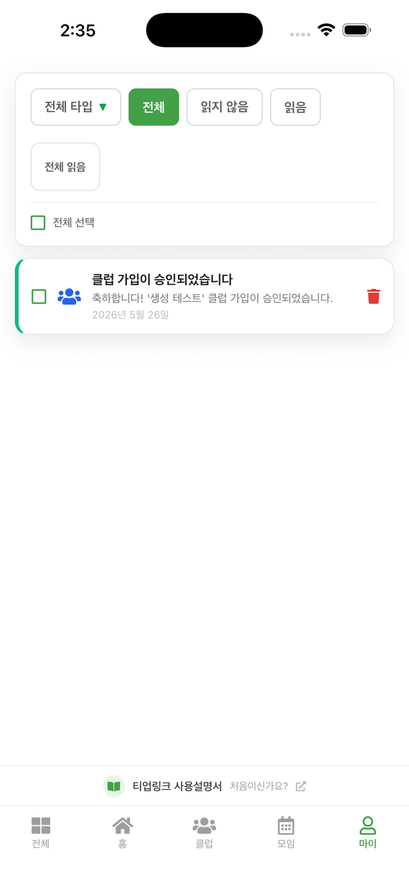

**마이 → 알림**. 모임 개설, 가입 승인, 정산 요청 같은 소식이 옵니다.

- **전체 타입 / 읽지 않음 / 읽음** 으로 거릅니다
- **전체 선택** 후 한꺼번에 읽음 처리하거나 지울 수 있습니다

---

## 부록 A. 안전하게 쓰기 — 신고와 차단

### 신고

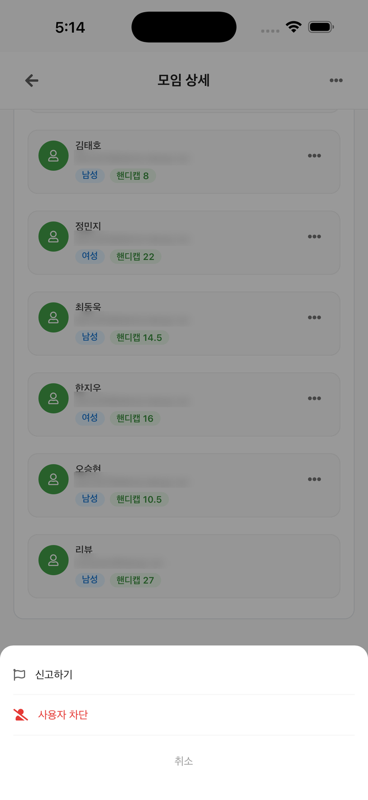

클럽·모임·공지·규정 화면 오른쪽 위, 그리고 참가자·멤버 목록의 각 줄에 **⋯** 버튼이 있습니다. 누르면 아래에서 메뉴가 올라옵니다.

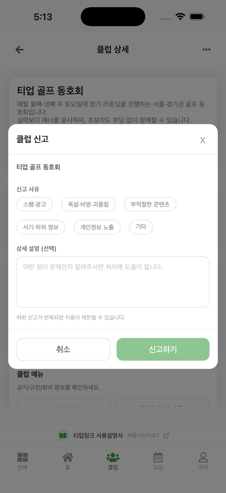

**⋯ → 신고하기** 를 누르면 사유를 고르는 창이 뜹니다.

- 사유는 **스팸·광고 / 욕설·비방·괴롭힘 / 부적절한 콘텐츠 / 사기·허위 정보 / 개인정보 노출 / 기타** 중에서 고릅니다
- **상세 설명**은 선택이지만, 어떤 점이 문제인지 적어 주시면 처리가 빨라집니다
- 접수된 신고는 운영진이 **24시간 이내**에 확인하고 조치합니다

> 허위 신고가 반복되면 이용이 제한될 수 있습니다.

### 차단

**⋯ → 사용자 차단**. 차단하면 그 사람이 만든 클럽·모임·공지와 참가자 목록이 더 이상 보이지 않습니다.

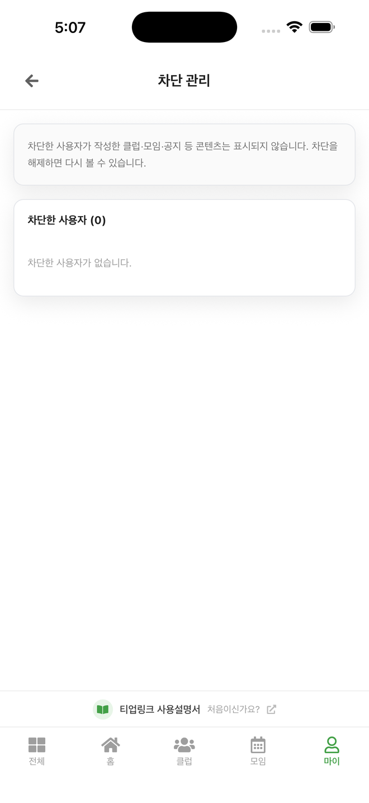

해제는 **마이 → 회원정보 수정 → 차단 관리** 에서 언제든 가능합니다.

### 부적절한 표현 차단

클럽명, 모임명, 공지, 규정, 닉네임에 욕설이나 광고성 문구가 들어가면 등록되지 않습니다.

---

## 부록 B. 공지·FAQ·문의

### 공지사항

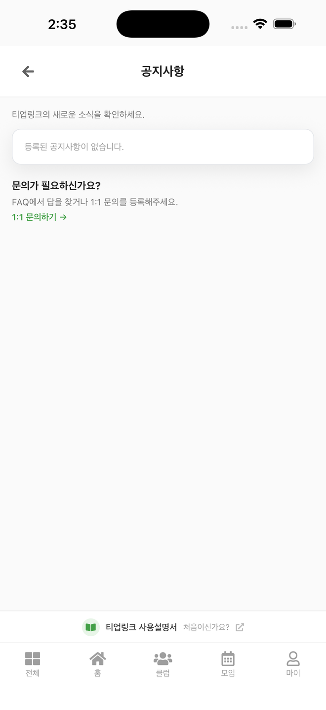

**전체 메뉴 → 공지사항**. 티업링크의 새 소식과 점검 안내가 올라옵니다.

### FAQ

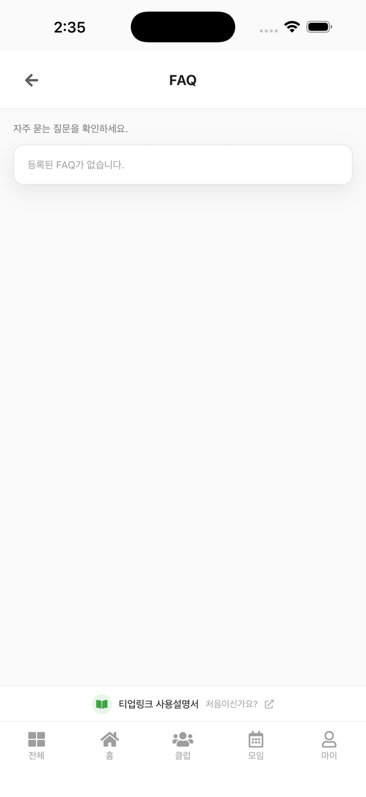

**전체 메뉴 → FAQ**. 자주 묻는 질문을 먼저 찾아보세요.

### 1:1 문의

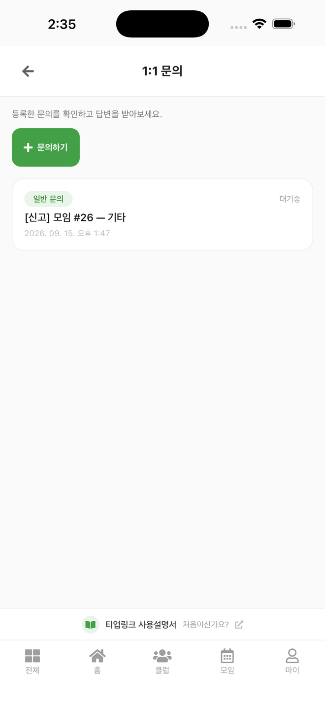

**전체 메뉴 → 1:1 문의**. **[+ 문의하기]** 로 새 문의를 남기고, 답변이 달리면 같은 화면에서 확인합니다.

### 이용약관

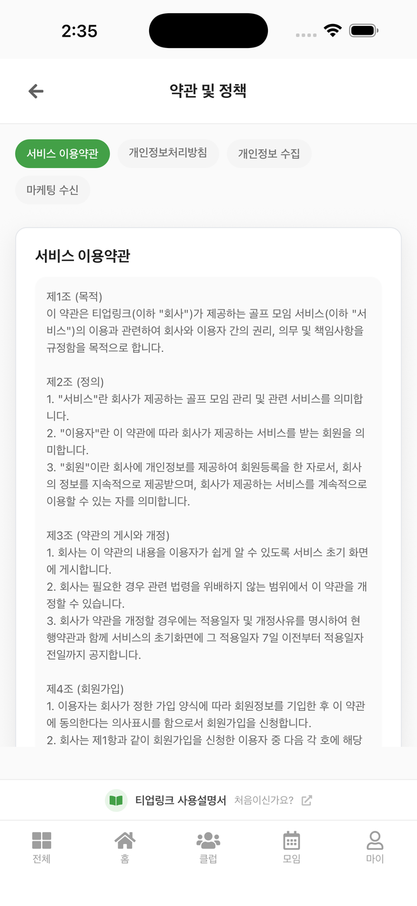

**전체 메뉴 → 이용약관**. 서비스 이용약관, 개인정보처리방침, 개인정보 수집, 마케팅 수신을 탭으로 나눠 볼 수 있습니다.

---

## 부록 C. 계정 관리

### 로그아웃

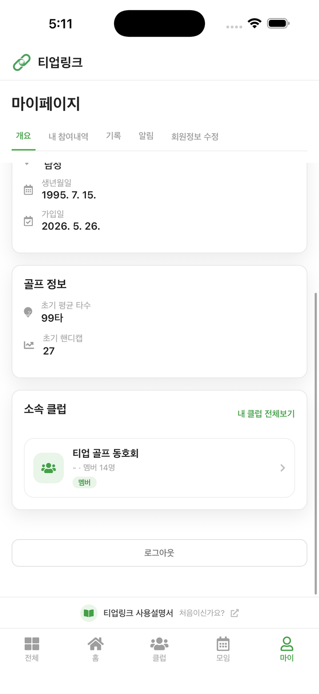

**마이 → 개요** 를 맨 아래까지 내리면 **로그아웃** 이 있습니다.

### 회원 탈퇴

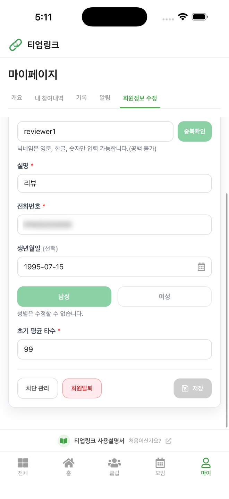

**마이 → 회원정보 수정** 을 맨 아래까지 내리면 **[차단 관리]** 와 **[회원탈퇴]** 가 있습니다.

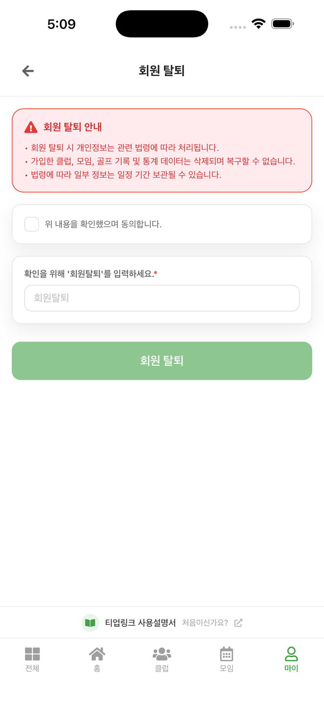

탈퇴는 두 가지를 모두 해야 버튼이 열립니다.

1. **위 내용을 확인했으며 동의합니다** 체크
2. 확인란에 **회원탈퇴** 를 그대로 입력

탈퇴하면 가입한 클럽·모임·골프 기록·통계가 모두 삭제되고 되돌릴 수 없습니다. 법령에 따라 일부 정보는 일정 기간 보관될 수 있습니다.

---

## 부록 D. 자주 묻는 질문

**클럽에 가입하지 않아도 쓸 수 있나요?**
클럽 목록을 둘러보고 개인 라운딩 기록을 남기는 것은 가능합니다. 모임 참가나 정산은 클럽에 속해야 합니다.

**클럽을 여러 개 가입할 수 있나요?**
네, 제한이 없습니다.

**가입 신청을 했는데 아무 일도 안 일어납니다.**
클럽 리더나 매니저가 승인해야 멤버가 됩니다. 승인되면 알림이 갑니다.

**모임을 만들 수 없습니다.**
모임 개설은 리더와 매니저만 가능합니다. 리더에게 매니저 권한을 요청하세요.

**앱에서 돈이 오가나요?**
아니요. 정산 기능은 금액을 계산하고 기록할 뿐입니다. 실제 송금은 앱 밖에서 합니다.

**생년월일과 성별을 꼭 넣어야 하나요?**
아니요. 선택 항목입니다. 넣으면 팀 편성과 티박스 추천에 쓰입니다.

**핸디캡은 어떻게 계산되나요?**
라운딩 기록이 쌓이면 앱이 자동으로 다시 계산합니다. 처음에 넣은 값은 시작점일 뿐입니다.

**차단한 사람을 다시 보려면?**
마이 → 회원정보 수정 → 차단 관리 → 차단 해제

---

## 문의

이 설명서에 없는 내용은 앱의 **1:1 문의** 또는 아래 메일로 연락 주세요.

**pixencrew@gmail.com**
